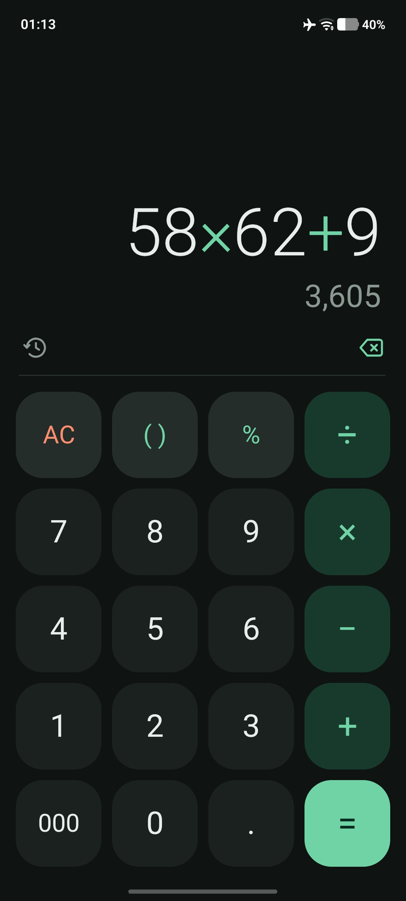

<p align="center">
  
</p>

<h1 align="center">Laughin coffen</h1>

<p align="center">
  Kalkulator Android yang presisi, dengan format angka Indonesia.<br>
  <a href="release/Laughin-coffen.apk?raw=true"><b>Unduh APK v1.1</b></a> · Android 6.0 ke atas
</p>

<p align="center">
  
</p>

## Fitur

- **Hitungan desimal tepat.** 0,1 + 0,2 = 0,3, karena memakai `BigDecimal`, bukan bilangan pecahan biner.
- **Persen ala kalkulator bisnis.** `200 + 10% = 220`, `200 − 10% = 180`, `200 × 10% = 20`, `200 ÷ 10% = 2000`.
- **Tombol `000`** untuk mengetik nominal rupiah dengan cepat.
- **Kurung pintar `( )`**, pratinjau hasil saat mengetik, dan ekspresi sebelumnya tetap terlihat setelah `=`.
- **Riwayat** 50 perhitungan terakhir. Ketuk untuk memakai hasilnya, tekan lama untuk menyalin.
- **Salin cepat.** Tekan lama layar angka untuk menyalin hasil; tekan lama tombol hapus untuk menghapus semua.
- **Format angka mengikuti bahasa HP**, misalnya 1.234.567,5 untuk Bahasa Indonesia.
- Mode terang/gelap otomatis, tampilan tegak dan mendatar, ikon adaptif, dan ikon bertema di Android 13+.

## Cara instal

1. Unduh [`Laughin-coffen.apk`](release/Laughin-coffen.apk?raw=true) di HP.
2. Buka filenya. Jika diminta, izinkan instal aplikasi dari sumber tersebut, lalu ketuk **Instal**.

## Struktur proyek

| Path | Isi |
|---|---|
| `src/id/kalkulatorku/Engine.java` | Mesin hitung: pengurai ekspresi dan format angka |
| `src/id/kalkulatorku/Calculator.java` | Logika tombol |
| `src/id/kalkulatorku/MainActivity.java` | Tampilan dan interaksi |
| `res/` | Tata letak, warna, tema, ikon |
| `art/logo-source.png` | Gambar asli logo |
| `tools/make_icons.py` | Membuat semua ukuran ikon dari logo |
| `test/` | Uji otomatis mesin hitung dan logika tombol |
| `release/` | APK siap pasang |

## Merakit dari kode sumber

Proyek ini dirakit tanpa Android Studio atau Gradle, cukup dengan alat dari paket Ubuntu:

```bash
sudo apt install openjdk-21-jdk-headless aapt dalvik-exchange zipalign apksigner android-sdk-platform-23 python3-pil
python3 tools/make_icons.py   # hanya perlu jika logo diganti
./build.sh                    # menghasilkan Laughin-coffen.apk
```

Menjalankan uji otomatis:

```bash
mkdir -p /tmp/kt && javac -source 8 -target 8 -d /tmp/kt src/id/kalkulatorku/Engine.java \
  src/id/kalkulatorku/Calculator.java test/id/kalkulatorku/CalcTest.java && java -cp /tmp/kt id.kalkulatorku.CalcTest
```

Kunci tanda tangan (keystore) sengaja tidak disertakan di repo ini. Jika belum ada, `build.sh` membuat kunci baru.
APK hasil kunci baru tidak bisa dipasang menimpa APK di folder `release/`, jadi hapus dulu versi lama sebelum memasangnya.
